# ZEIKIN

月給と賞与から、所得税・住民税・社会保険料と手取りを計算して、給与明細の形で表示する Web アプリです。

**https://zeikin-tedori.pages.dev/**

| | |
| --- | --- |
| 対象の制度 | 2026年（令和8年）の税制と保険料率（所得税は令和8年分、住民税はその所得にかかる令和9年度分） |
| 入力 | 月給（万円）・賞与の年間合計（万円）・都道府県・社会保険の加入・40〜64歳か |
| 出力 | 給与明細（月額／年額）、会社の負担、計算の途中の数字、月給を変えたときの図、CSV・Excel・JSON・Markdown |
| 動く場所 | ブラウザだけ。計算のための通信はしません（CSP で外への通信を禁じています）。ただし条件は URL に入るので、リンクを開くとその URL は配信元に届きます |
| バージョン | 2.2.4（[CHANGELOG.md](CHANGELOG.md)） |

詳しい仕様は次の 3 つの文書にあります。この README はその全体像と、コードの読み方をまとめたものです。

| 文書 | 中身 |
| --- | --- |
| [docs/calculation.md](docs/calculation.md) | 計算の仕様・料率・端数処理・出典 |
| [docs/export.md](docs/export.md) | 書き出しの形式（CSV・Excel・JSON・Markdown） |
| [docs/design.md](docs/design.md) | 画面のデザインの考え方・色・部品の寸法 |

## 目次

- [できること](#できること)
- [計算のしくみ](#計算のしくみ)
  - [額面から手取りまで](#額面から手取りまで)
  - [計算の順番](#計算の順番)
  - [社会保険料：だれがいくら払うか](#社会保険料だれがいくら払うか)
  - [所得税](#所得税)
  - [住民税](#住民税)
  - [会社の負担](#会社の負担)
  - [月給を変えると](#月給を変えると)
  - [前提としていること](#前提としていること)
- [アプリの作り](#アプリの作り)
  - [層の分け方](#層の分け方)
  - [画面の部品](#画面の部品)
  - [入力から表示までのデータの流れ](#入力から表示までのデータの流れ)
  - [URL での共有](#url-での共有)
  - [書き出し](#書き出し)
  - [ディレクトリ構成](#ディレクトリ構成)
- [テスト](#テスト)
- [開発](#開発)
- [公開](#公開)
- [料率の更新](#料率の更新)
- [ライセンス](#ライセンス)

## できること

- 入力と同時に計算し、給与明細と同じ「支給」「控除」「差引支給額」の形で表示する。月額（賞与のない月）と年額を切り替えられる
- 健康保険は協会けんぽの 47 都道府県別の料率。介護保険（40〜64歳）、子ども・子育て支援金（2026年4月から）にも対応
- 標準報酬月額の等級、標準賞与額の上限、本人負担分の端数処理（50銭以下切り捨て）まで、実務と同じ扱い
- 会社が負担している社会保険料・労災保険・子ども・子育て拠出金を別に表示し、「会社が払う総額」を出す
- 標準報酬月額・課税所得など、計算の途中の数字を確かめられる
- 「月給を変えると」の図で、月給 10〜120 万円の手取り・税金・社会保険の内訳と、1 万円の昇給で手取りがいくら増えるかを見られる
- 入れた条件を URL に残すので、リンクを送ればそのまま同じ試算を開ける。印刷・PDF 保存にも対応（A4）
- 試算結果を CSV・Excel（.xlsx）・JSON・Markdown で書き出せる


## 計算のしくみ

### 額面から手取りまで

手取りは「額面 − 本人が払う保険料 − 所得税 − 住民税」です。会社が払う保険料は手取りには関係しません。

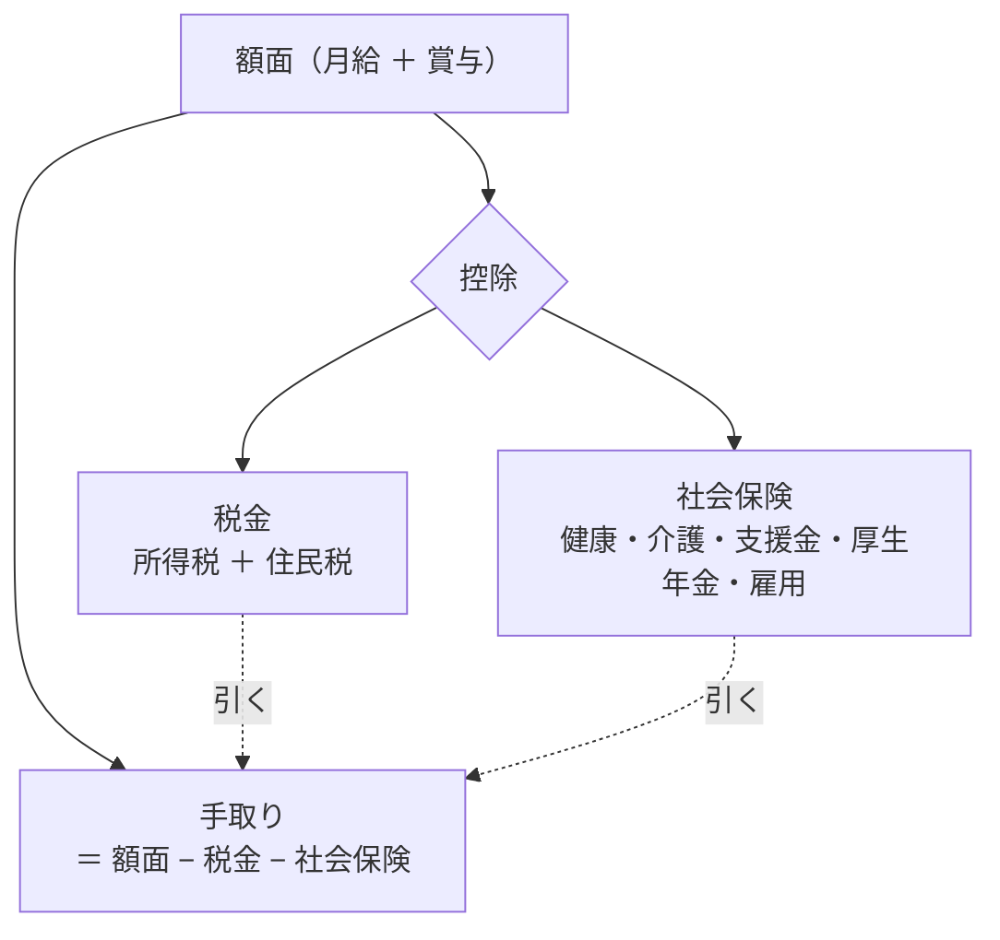

例として、月給 30 万円・賞与なし・東京都・40 歳未満の 1 か月分は次のとおりです（手取り率 79.9%）。

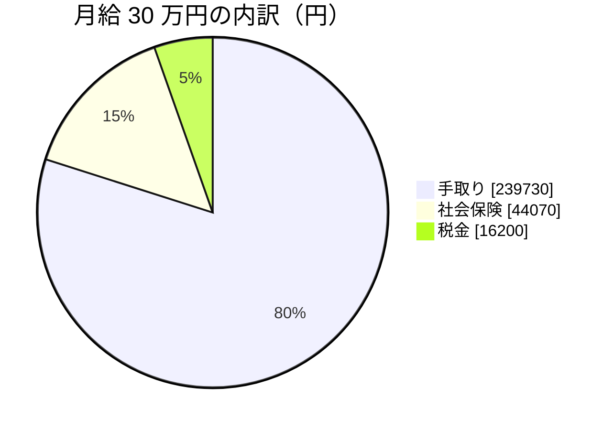

| 区分 | 項目 | 月額（円） |
| --- | --- | ---: |
| 支給 | 給与 | 300,000 |
| 控除 | 所得税 | 3,700 |
| 控除 | 住民税 | 12,500 |
| 控除 | 健康保険 | 14,775 |
| 控除 | 子ども・子育て支援金 | 345 |
| 控除 | 厚生年金 | 27,450 |
| 控除 | 雇用保険 | 1,500 |
| 控除 | 控除合計 | 60,270 |
| | **差引支給額（手取り）** | **239,730** |

### 計算の順番

入口は `src/domain/tax/calculate.ts` の `calculatePay` です。ここは順番に呼んでまとめるだけで、中身はファイルごとに分かれています。

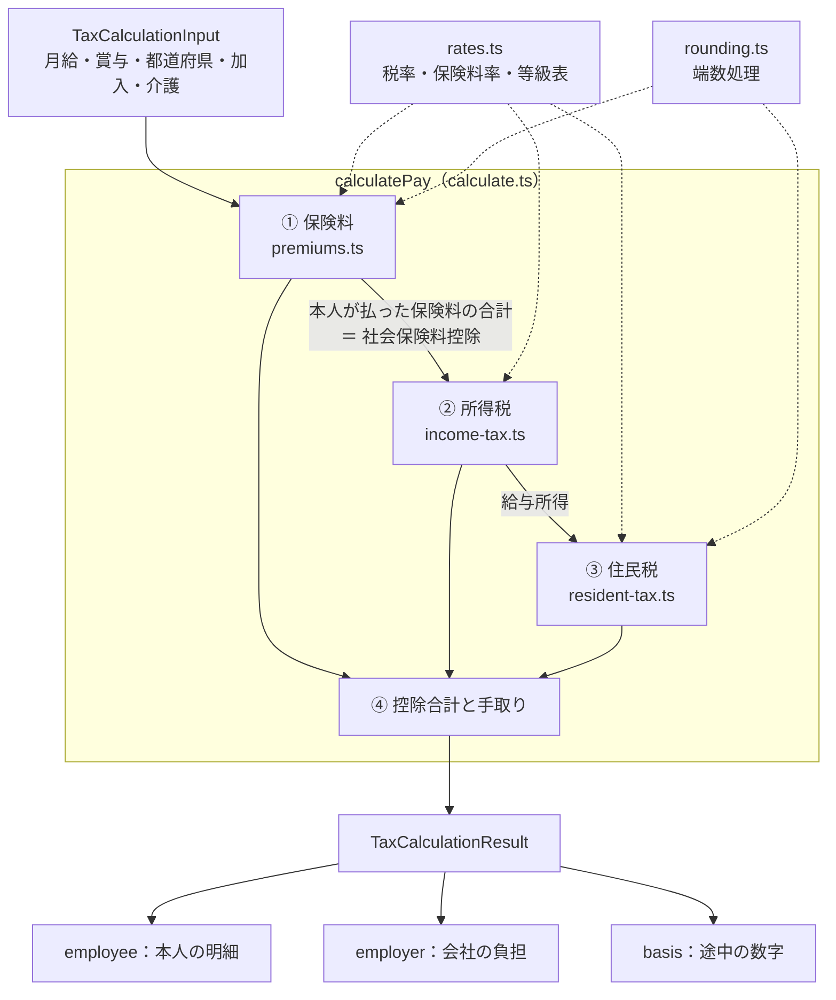

保険料を先に計算するのは、所得税と住民税が「本人が払った保険料」を社会保険料控除として引いてから計算するためです。会社が払う分は `employer` の側にだけ入り、税金にも手取りにも使いません。

### 社会保険料：だれがいくら払うか

「どの保険料を、何に掛けて、だれが払うか」は `premiums.ts` の表 `PREMIUMS` 1 つで決めています。本人の控除合計も会社の負担も、この表を足し上げて作ります。保険料を増やすときは、この表に 1 行足すだけで合計にも入ります。

| 保険料 | 掛ける金額 | 料率 | 払う人 | かかる人 |
| --- | --- | --- | --- | --- |
| 健康保険 | 健康保険の標準報酬 | 都道府県別（東京都 9.85%） | 折半 | 社会保険に加入 |
| 介護保険 | 健康保険の標準報酬 | 1.62% | 折半 | 加入 かつ 40〜64歳 |
| 子ども・子育て支援金 | 健康保険の標準報酬 | 0.23% | 折半 | 社会保険に加入 |
| 厚生年金 | 厚生年金の標準報酬 | 18.3% | 折半 | 社会保険に加入 |
| 子ども・子育て拠出金 | 厚生年金の標準報酬 | 0.36% | 会社のみ | 社会保険に加入 |
| 雇用保険 | 実際の給与・賞与 | 本人 0.5%・会社 0.85% | 別々の率 | 全員（社会保険の加入と関係なくかかる） |
| 労災保険 | 実際の給与・賞与 | 0.3% | 会社のみ | 全員（同上） |

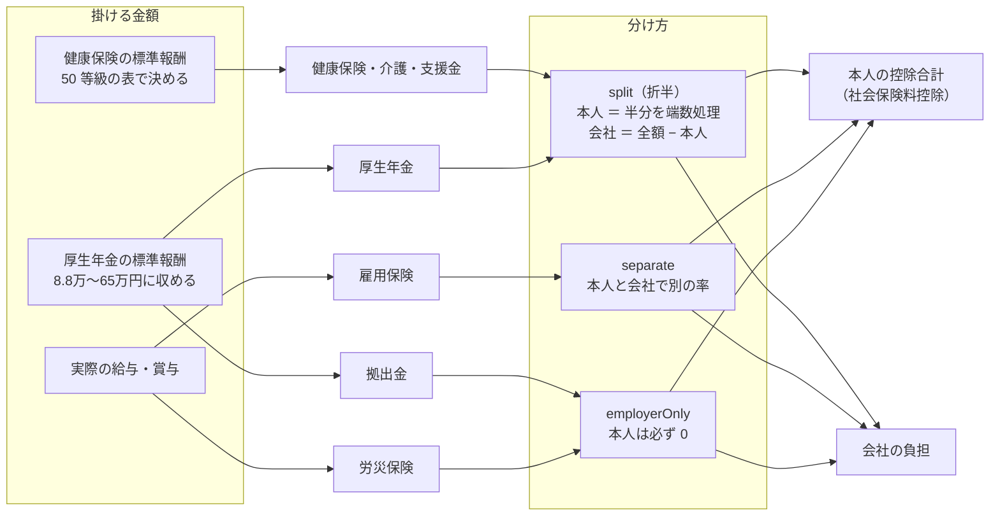

標準報酬と賞与の扱いは次のとおりです。

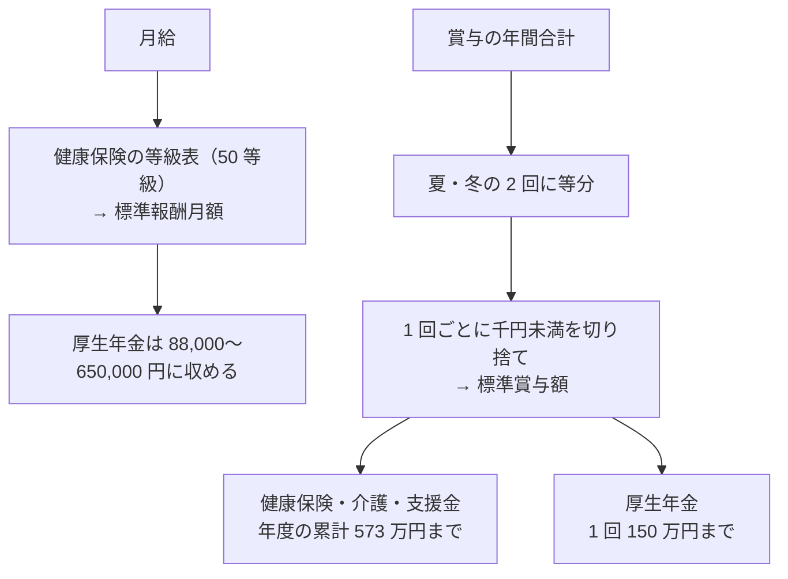

本人負担分は「50銭以下を切り捨て、50銭を超えたら切り上げ」、会社負担分は「全額 − 本人負担分」です。半分に端数が出るときは本人と会社で 1 円だけ違うことがあります（例：標準報酬 41 万円の健康保険 40,385 円は、本人 20,192 円・会社 20,193 円）。

### 所得税

年末調整を終えた後の、1 年分の税額を計算します（`income-tax.ts`）。

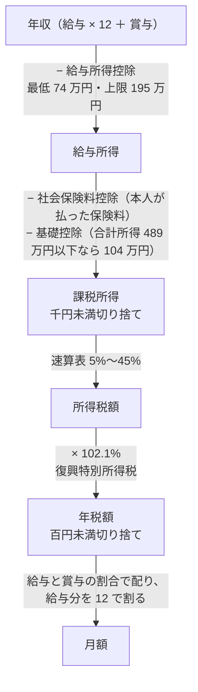

月給 30 万円・賞与なし・東京都の場合：

| 段階 | 金額（円） |
| --- | ---: |
| 年収 | 3,600,000 |
| 給与所得（3,600,000 × 70% − 80,000） | 2,440,000 |
| 社会保険料控除 | 528,840 |
| 基礎控除 | 1,040,000 |
| 課税所得 | 871,000 |
| 年税額（871,000 × 5% × 102.1%、百円未満切り捨て） | 44,400 |
| 月額 | 3,700 |

月額は毎月の源泉徴収額（月額表）とは一致しません。年末調整で精算された後の負担を 12 で割ったものです。給与所得控除と基礎控除の段階は [docs/calculation.md](docs/calculation.md) にあります。

### 住民税

標準税率で計算します（`resident-tax.ts`）。前年も同じ年収だったとして、今年の所得にかかる分を今の天引き額とみなします。

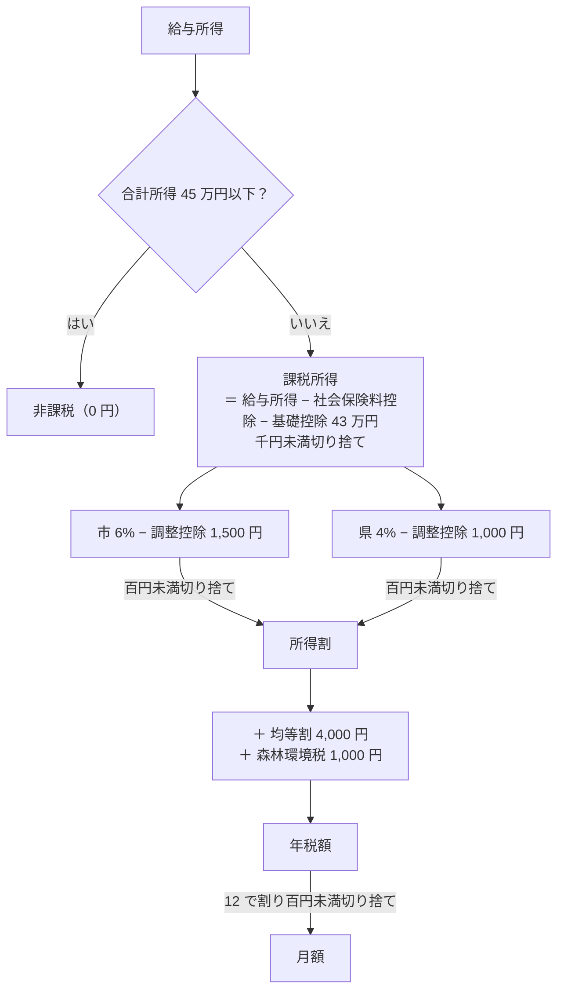

### 会社の負担

会社は額面のほかに、社会保険料の会社負担分・雇用保険の会社負担分・労災保険・子ども・子育て拠出金を払っています。所得税と住民税は本人だけの負担なので含みません。

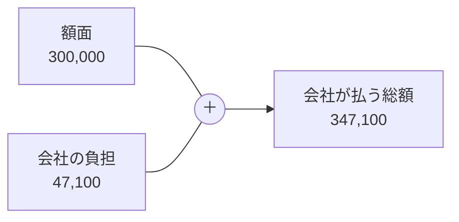

| 会社の負担（月給 30 万円・東京都） | 月額（円） |
| --- | ---: |
| 健康保険 | 14,775 |
| 子ども・子育て支援金 | 345 |
| 厚生年金 | 27,450 |
| 子ども・子育て拠出金 | 1,080 |
| 雇用保険 | 2,550 |
| 労災保険 | 900 |
| 合計 | 47,100 |

### 月給を変えると

画面の図は、月給を 1 万円刻みで変えて `calculatePay` を呼び直し、賞与のない月の内訳を積み上げて描いています（`curve.ts`）。月給が上がるほど所得税の段階が上がり、手取り率は下がっていきます。

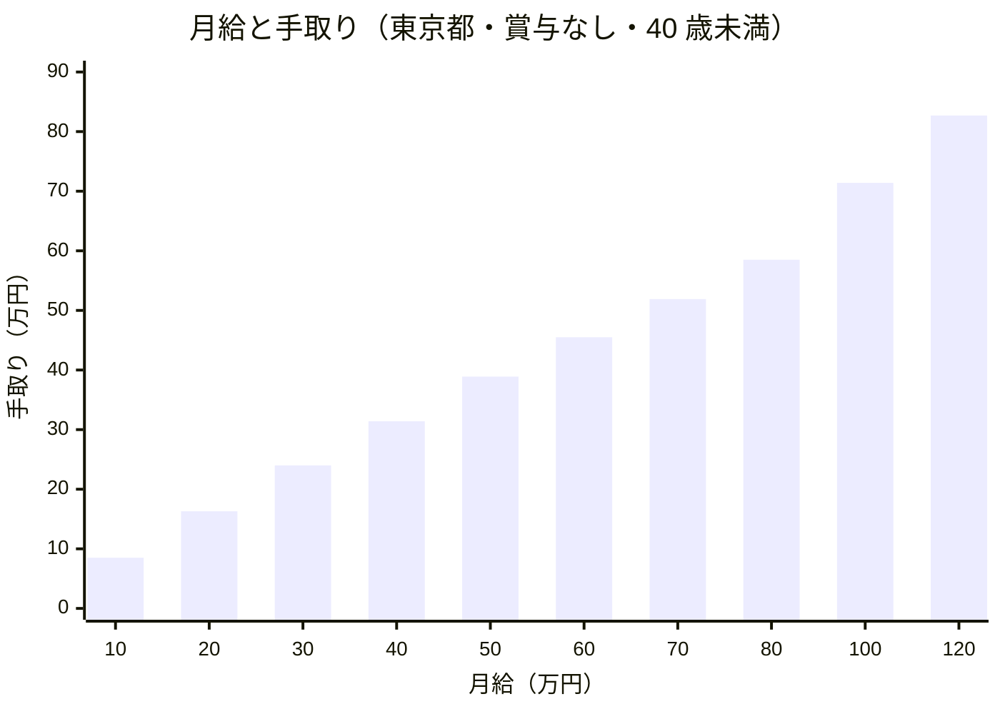

| 月給（万円） | 手取り（円） | 税金（円） | 社会保険（円） | 手取り率 | 会社の負担（円） |
| ---: | ---: | ---: | ---: | ---: | ---: |
| 10 | 85,194 | 400 | 14,406 | 85.2% | 15,409 |
| 20 | 162,745 | 7,875 | 29,380 | 81.4% | 31,400 |
| 30 | 239,730 | 16,200 | 44,070 | 79.9% | 47,100 |
| 40 | 313,964 | 25,858 | 60,178 | 78.5% | 64,256 |
| 50 | 388,509 | 38,041 | 73,450 | 77.7% | 78,500 |
| 60 | 454,522 | 58,758 | 86,720 | 75.8% | 92,746 |
| 70 | 518,776 | 82,466 | 98,758 | 74.1% | 105,650 |
| 80 | 584,560 | 112,150 | 103,290 | 73.1% | 110,832 |
| 100 | 713,567 | 172,566 | 113,867 | 71.4% | 122,707 |
| 120 | 827,001 | 246,541 | 126,458 | 68.9% | 136,600 |

- 厚生年金は標準報酬月額 65 万円が上限なので、それより上では保険料が増えません。図ではその月給に点線を引きます（`findPensionCap`）
- 社会保険料は標準報酬月額の等級で段になって増えるため、1 万円の昇給で等級が上がると手取りの増え方が小さくなります。図の上に「1 万円上がると手取りはいくら増えるか」と、等級が上がるかどうかを出します（`marginalTakeHome`）
- 図の右端は 120 万円が基本で、いまの月給がはみ出すときだけ広げます（最大 500 万円）

### 前提としていること

- 給与だけの収入がある会社員。扶養控除・配偶者控除・生命保険料控除・iDeCo などは考えない
- 健康保険は協会けんぽ。健康保険組合の独自の料率は考えない
- 雇用保険は「一般の事業」、労災保険は「94 その他の各種事業」（1000分の3）
- 賞与は夏と冬の 2 回に等分して支給する
- 住民税は、前年も同じ年収だった場合の額を今の天引き額とみなす

料率の出典は [docs/calculation.md](docs/calculation.md#出典2026年11月に確認) にあります。

## アプリの作り

| 使っているもの | 役目 |
| --- | --- |
| React 19 ＋ TypeScript 5.7 | 画面 |
| Vite 6 | 開発サーバーとビルド（terser で圧縮、`console` は消す） |
| Vitest | 単体テスト |
| ESLint 9（typescript-eslint・react-hooks） | 静的検査 |
| CSS 1 ファイル（`src/styles/app.css`） | 見た目のすべて。UI ライブラリは使わない |
| BIZ UDPゴシック（英数字だけ同梱） | 金額の書体。CSP で外部フォントを読まないため同梱 |
| fflate | Excel の zip 化。Excel を押したときだけ読み込む |
| Cloudflare Pages | 公開 |

### 層の分け方

計算（`domain`）は画面を知らず、画面（`features`）は計算の中身を知りません。書き出しの中身を作る関数も DOM に触らないので、すべて Node 上でテストできます。

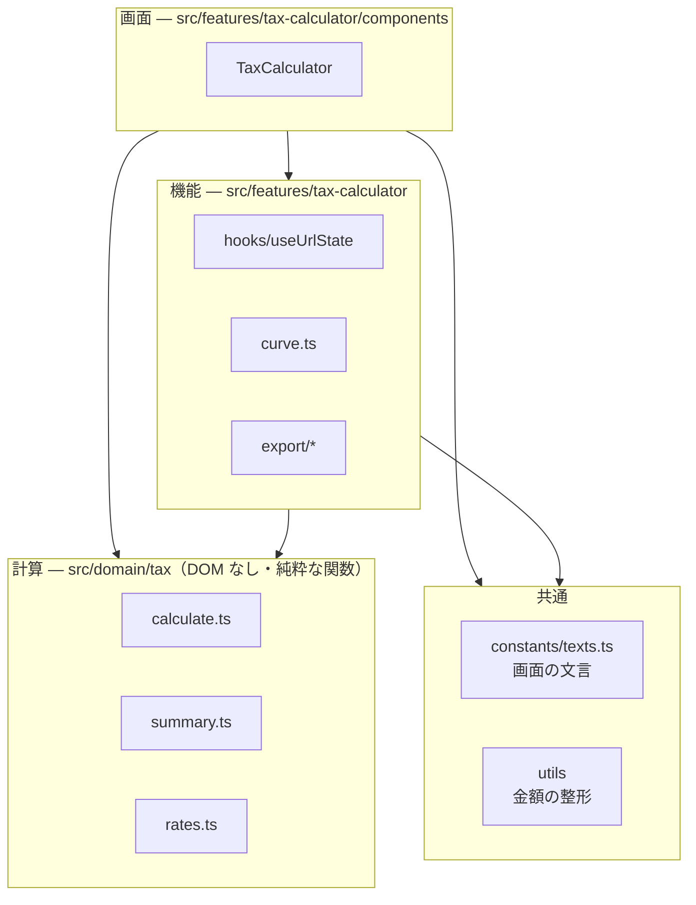

import にはパスの別名を使っています（`vite.config.ts`・`tsconfig.app.json`）。

| 別名 | 場所 |
| --- | --- |
| `@` | `src` |
| `@domain` | `src/domain` |
| `@features` | `src/features` |
| `@utils` | `src/utils` |
| `@constants` | `src/constants` |

### 画面の部品

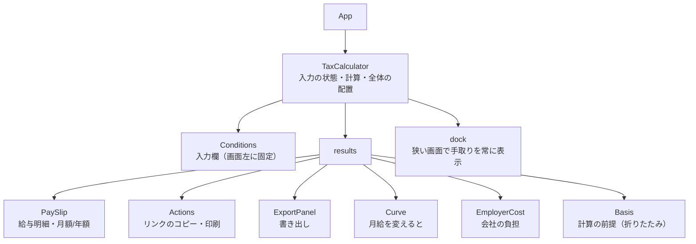

画面の幅による配置は次のとおりです（詳しくは [docs/design.md](docs/design.md)）。

| 幅 | 配置 |
| --- | --- |
| 960px 未満 | 条件の下に明細。画面の下に手取りを常に出す |
| 960px 以上 | 左に条件（固定）、右に明細 |
| 1280px 以上 | さらに会社の負担と計算の前提を 2 列にする |

### 入力から表示までのデータの流れ

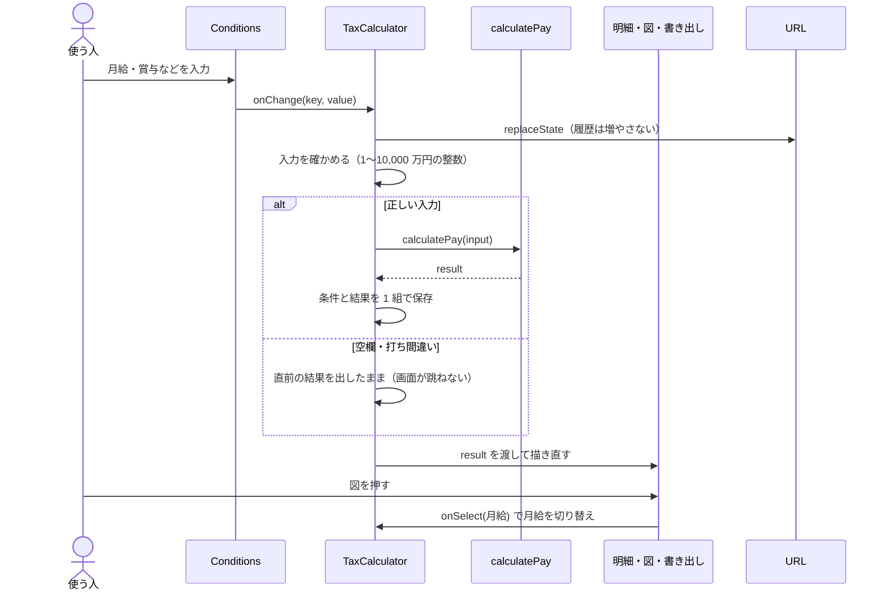

- 入力は万円、計算は円です（`MAN = 10_000`）
- 空欄は打ち直しの途中とみなし、エラーとして出しません
- 書き出しで条件と結果が食い違わないよう、計算に使った条件と結果は必ず 1 組で持ちます

### URL での共有

入れた条件は `useUrlState.ts` が URL のクエリに書きます。リンクを開くと、その条件で始まります。おかしな値は無視して初期値を使います。

| キー | 意味 | 例 |
| --- | --- | --- |
| `s` | 月給（万円） | `s=30` |
| `b` | 賞与の年間合計（万円） | `b=60` |
| `pref` | 都道府県 | `pref=東京都` |
| `si=0` | 社会保険に加入していない | 加入なら付けない |
| `care=1` | 介護保険あり（40〜64歳） | 対象外なら付けない |

例：`https://zeikin-tedori.pages.dev/?s=30&b=60&pref=東京都`

### 書き出し

中身は `model.ts` の `buildExportDocument` で 1 回だけ作り、各形式はそれを書式に変えるだけです。形式によって数字や項目が食い違いません。ブラウザに触るのは保存を受け持つ `download.ts` だけです。

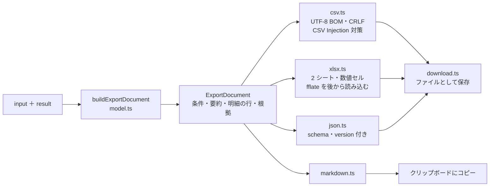

ファイル名には条件が入ります（例：`給与明細_2026_月給30万円_賞与60万円_東京都.csv`）。形式ごとの細かい仕様と JSON の例は [docs/export.md](docs/export.md) にあります。

### ディレクトリ構成

```
.
├── index.html
├── public/
│   ├── _headers                 Cloudflare Pages のセキュリティ用ヘッダーとキャッシュ
│   └── favicon.svg
├── docs/
│   ├── calculation.md           計算の仕様と出典
│   ├── design.md                画面のデザイン
│   └── export.md                書き出しの形式
├── src/
│   ├── main.tsx                 起動。書体と CSS を読み込む
│   ├── App.tsx
│   ├── design-lint.test.ts      作り物っぽい飾りが入っていないかの検査
│   ├── domain/tax/
│   │   ├── rates.ts             税率・保険料率・等級表（年度が変わったらここだけ直す）
│   │   ├── premiums.ts          保険料。だれが払うかの表（PREMIUMS）と、本人・会社への分け方
│   │   ├── income-tax.ts        所得税（給与所得控除・基礎控除・速算表）
│   │   ├── resident-tax.ts      住民税
│   │   ├── rounding.ts          端数処理
│   │   ├── summary.ts           手取り率と、控除を税金・社会保険に分ける関数
│   │   ├── calculate.ts         上を順に呼んで明細の形にまとめる入口
│   │   ├── tax.ts               入力と結果の型
│   │   ├── index.ts             外に見せるもの
│   │   ├── calculate.test.ts    手計算との照合
│   │   ├── premiums.test.ts     負担の分け方の決まり
│   │   └── regression.test.ts   約 9 万通りの結果の見張り
│   ├── features/tax-calculator/
│   │   ├── components/
│   │   │   ├── TaxCalculator.tsx  入力の状態と画面全体
│   │   │   ├── Conditions.tsx     入力欄
│   │   │   ├── PaySlip.tsx        給与明細
│   │   │   ├── Actions.tsx        リンクのコピー・印刷
│   │   │   ├── ExportPanel.tsx    書き出し
│   │   │   ├── Curve.tsx          月給を変えると（図）
│   │   │   ├── EmployerCost.tsx   会社の負担
│   │   │   └── Basis.tsx          計算の前提と途中の数字
│   │   ├── hooks/useUrlState.ts   条件を URL に読み書きする
│   │   ├── curve.ts               図の点・厚生年金の頭打ち・1 万円の昇給
│   │   ├── curve.test.ts
│   │   └── export/
│   │       ├── model.ts           書き出しの中身（全形式の元）
│   │       ├── formats.ts         形式の一覧とファイル名
│   │       ├── csv.ts / xlsx.ts / json.ts / markdown.ts
│   │       ├── download.ts        ブラウザでの保存（DOM に触るのはここだけ）
│   │       └── export.test.ts
│   ├── constants/texts.ts       画面の文言
│   ├── utils/                   金額の整形
│   └── styles/app.css           見た目のすべて
├── vite.config.ts
├── eslint.config.js
└── tsconfig*.json
```

## テスト

`npm test` で 6 ファイル・75 件のテストが走ります。

| ファイル | 確かめていること |
| --- | --- |
| `calculate.test.ts` | 月給 30 万円・東京都の手計算と一致する。どの条件でも「額面 ＝ 手取り ＋ 控除合計」 |
| `premiums.test.ts` | 月給 5〜200 万円 × 47 都道府県 × 賞与 4 通りで、折半は本人と会社の差が 1 円以内、会社のみの保険料は本人 0 円、合計が項目の足し算と一致、手取りが会社の負担で減っていない |
| `regression.test.ts` | 約 9 万通りの条件の結果をまとめたハッシュが前と同じ（コードの整理で結果が変わらない） |
| `curve.test.ts` | 図の点・厚生年金の頭打ち・1 万円の昇給の計算 |
| `export.test.ts` | 明細の各行の足し算が合計の行になる、額面 − 控除合計 ＝ 手取り、JSON を読み戻すと同じ中身 |
| `design-lint.test.ts` | ぼかした影・グラデーション・絵文字など、[docs/design.md](docs/design.md) で使わないと決めた飾りがない |

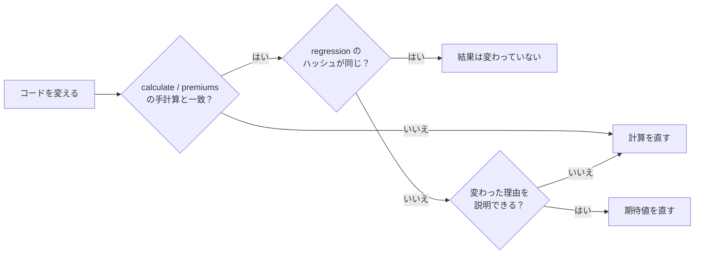

## 開発

Node.js 20 以上が必要です。

```bash
npm install
npm run dev     # http://localhost:5173
npm test        # 単体テスト
npm run lint
npm run build   # 型チェック（tsc -b）のあと dist に出力
```

| スクリプト | 中身 |
| --- | --- |
| `dev` | 開発サーバー |
| `build` | `tsc -b && vite build` |
| `preview` | ビルドしたものを手元で開く |
| `test` | `vitest run` |
| `lint` | `eslint .` |
| `security:audit` / `security:fix` | `npm audit` / `npm audit fix` |

## 公開

Cloudflare Pages で公開しています。`main` に入ると自動でビルドして公開し、プルリクエストごとに確認用の URL も作られます。

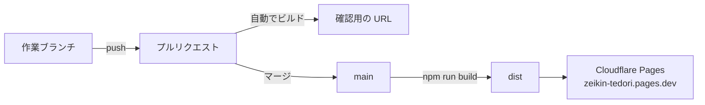

- ビルドコマンド: `npm run build`
- 出力先: `dist`
- セキュリティ用のヘッダーは `public/_headers` に書いています。CSP は自分のサイトの中のものだけを読む設定で、外部のスクリプト・フォント・通信を許していません。`/assets/*` は 1 年間キャッシュします

## 料率の更新

毎年 3〜4 月に協会けんぽの健康保険料率・介護保険料率と雇用保険料率が、12 月の年末調整前後に所得税の控除額が変わることがあります。

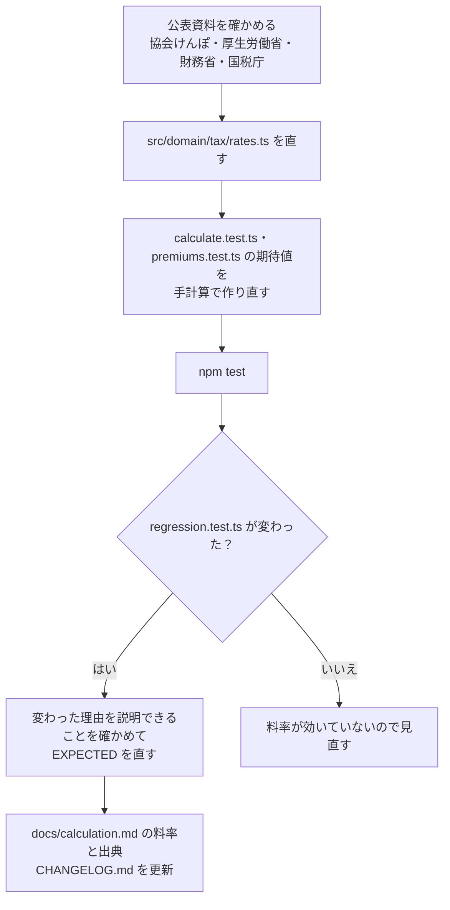

保険料を足すときは `premiums.ts` の `PREMIUMS` に 1 行足すだけで、本人の控除合計と会社の負担の両方に入ります。

## ライセンス

MIT
